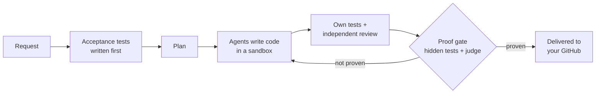

<div align="center">

# Ayush Saxena

**Software Engineer II @ JPMorgan Chase · Building [Warrantee](https://ayush1906saxena.github.io/warrantee/) · Bengaluru, India**

I build systems that ship software on their own and prove it works: AI agents that write the code, and the infrastructure that won't let them ship anything unproven.

[](https://ayush1906saxena.github.io/warrantee/)
[](https://www.linkedin.com/in/ayush-saxena-a766b418b/)
[](mailto:ayushsaxena.official01@gmail.com)
[](https://leetcode.com/)
[](#)

</div>

---

## 🔏 &nbsp;Now building: [Warrantee](https://ayush1906saxena.github.io/warrantee/)

> **AI engineers that answer for your app.** You describe the fix or the feature; a team of AI agents plans it, writes it, tests it and reviews it, and nothing reaches your repository until it clears an evidence gate: the project's own tests, hidden checks written before the code, and an independent review. Built, proven, shipped.



**Under the hood** (private source, one month of building):

| | |
|---|---|
| 🧠 **Model gateway** | Every model call goes through one door: a learned router picks the model per task from real outcomes, slow calls are raced against a fast backup, and every token is costed. Model-agnostic: Claude, GPT and open models on any host. |
| 🛡️ **Policy gateway** | Every tool call (git, CI, Kubernetes, databases) passes an OPA policy check through MCP servers; agents never touch credentials. |
| ✅ **Proof gate** | A change ships only on evidence: hidden acceptance checks written before the code, the project's own suite, an independent reviewer from another model family, and a calibrated judge. |
| 🧪 **Sandboxed CI** | Every test run happens in an isolated Kubernetes job, across Python, Java, Node and Go. |
| 📏 **Graded on real code** | Benchmarked on real tasks from pydantic, gson, jsoup, SQLAlchemy, Hugo, ESLint and more, scored by each project's own upstream tests ([fixtures](https://github.com/Ayush1906saxena?tab=repositories&q=meridian-fixture)). |

```
721   commits since 20 Sep 2026
138k  lines of code: Java 21 / Spring Boot services, Python, TypeScript
 17   services and MCP tool servers on Kubernetes
317   test classes · 41 architecture decision records · 30 versioned prompts
 32   research passes: every engine change starts from the literature
```


---

### 🔨 &nbsp;Other things I've built

<table>
<tr>
<td width="50%" valign="top">

#### [ChaosGuard AI](https://github.com/Ayush1906saxena/ChaosGuard)
Autonomous security and chaos-engineering platform with a **3-tier LLM agent architecture**: static analysis, then 4 LangGraph-orchestrated agents, then 8 specialised agents for attack-chain construction and cascading-failure simulation. Fully local inference, zero API cost.


</td>
<td width="50%" valign="top">

#### [ArchitectIQ](https://github.com/Ayush1906saxena/ArchitectIQ)
AI-powered system design academy: **174 lessons**, an adaptive AI interviewer, interactive failure labs and D3.js architecture diagrams, with an Ollama-backed quizzing engine.


</td>
</tr>
</table>

---

### 💼 &nbsp;At work

> At JPMorgan Chase, I led the migration of the **LOANIQ financial platform** to Kubernetes with near-zero downtime, built **Workmate**, a developer productivity tool that provisions production environments in **under 2 hours** through automated Terraform and CI/CD pipelines, and unified **300+ interfaces** into a single deployment pipeline, **cutting release time by 90%**.

```
650+  LeetCode problems solved (DSA, DP, system design)
 90%  deployment time cut: 300+ interfaces unified into 1 CI/CD pipeline
 90%  query latency cut: Oracle OLTP/OLAP schema split for financial databases
< 2h  environment provisioning with Workmate (previously days of manual setup)
```

---

### 🛠️ &nbsp;Tech stack

<p align="center">
  
  <br/>
  
</p>

---

### 📈 &nbsp;GitHub

<div align="center">


&nbsp;&nbsp;


<br/>


</div>

---

<div align="center">
<sub>Fintech platforms at JPMorgan Chase by day. Software that proves itself, by night.</sub>
</div>
