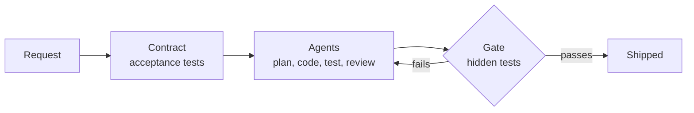

## Ayush Saxena

Software Engineer II at **JPMorgan Chase**, Bengaluru. I build AI agents that fix real code, the tooling they run on, and the backend systems underneath.

**[Portfolio](https://ayush1906saxena.github.io/)** · **[LinkedIn](https://www.linkedin.com/in/ayushsaxenaofficial/)** · **[Warrantee](https://ayush1906saxena.github.io/warrantee/)**

### At JPMorgan Chase

Intern (2023) → Software Engineer I → Software Engineer II (2026). The engineer my team gave its AI work to.

- **Build-break agent, end to end.** It reads a build break, files the ticket, finds the repository, branches, writes the fix, runs the pipeline, then updates and closes the ticket on its own.
- **MCP servers** that connect AI agents to Bitbucket, Jira and Jules: code review **40% faster**.
- **Oracle to cloud PostgreSQL**: helped migrate a lending platform's **terabytes** of data and **12+ microservices** onto Kubernetes, with **99.9% uptime** through the cutover.
- Release pipelines gated on static analysis, tests and container scans: **35% fewer** production incidents.

### Meridian, the engine behind Warrantee

An AI engineering team that has to prove its work. A plain-English request becomes a tested, reviewed code change, and nothing ships until it passes tests the coding agents never saw.

| Broken changes stopped | Correct changes let through | Benchmark tasks with flawed labels found |
|:---:|:---:|:---:|
| **29 / 29** | **12 / 19** (up from 5) | **136 / 731** |

Results on SWE-Bench Pro tasks. 8 Java 21 and Spring Boot 3 services on Kubernetes, a Postgres transactional outbox, OPA policy on every tool call, and a learned model router. Source is private.

### Other things I've built

| Project | What it does | Stack |
|---|---|---|
| [**ChaosGuard**](https://github.com/Ayush1906saxena/ChaosGuard) | Give it a GitHub URL; four escalating tiers return an audit, attack chains and fix PRs. Runs on local models: nothing leaves the machine. | Spring Boot · Kafka · Python · Ollama · ChromaDB |
| [**ArchitectIQ**](https://github.com/Ayush1906saxena/architectiq) | A system design academy (174 lessons) and a mock interviewer that never gives the answer and probes every technology you name. | Next.js · React · FastAPI · Python |
| [**NetraAI**](https://github.com/Ayush1906saxena/NetraAI) | Diabetic retinopathy screening from a fundus photo, with an ensemble of two RETFound vision transformers. | PyTorch · FHIR |
| [**TradingBot**](https://github.com/Ayush1906saxena/TradingBot) | Algorithmic trading for the NSE: 14 strategies, backtesting, paper trading and live execution. | Python · Streamlit |
| [**PaySecure**](https://github.com/Ayush1906saxena/PaySecure) | UPI payments by voice in Hindi or English, confirmed with fingerprint or Face ID through WebAuthn. | Next.js · FastAPI · WebAuthn |

### Stack

**AI:** multi-agent systems, MCP, LLM evaluation, model routing, RAG · **Backend:** Java 21, Spring Boot 3, Kafka, Python, Node.js · **Data:** PostgreSQL, Oracle, MongoDB · **Platform:** Kubernetes, Docker, Terraform, AWS, Jenkins · **Frontend:** React, TypeScript, Next.js

B.Tech, Computer Science and Engineering, VIT (2023) · AWS Certified Cloud Practitioner · 650+ LeetCode problems
